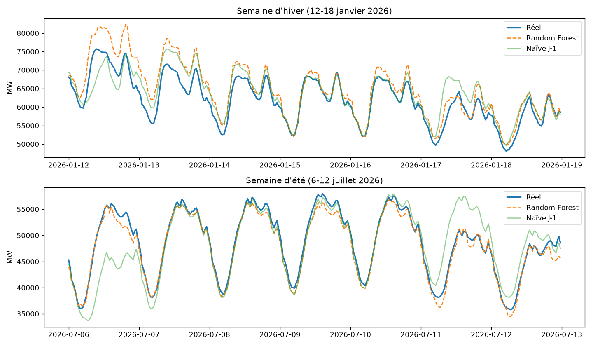

# Prévision de la consommation électrique nationale (RTE éCO2mix)

Prévision de la consommation électrique française au pas de 30 minutes, à partir des données
ouvertes de RTE. Comparaison de baselines naïves et de trois modèles (Ridge, Random Forest,
XGBoost) avec une validation temporelle sans fuite de données.

## Objectif
Prévoir la consommation nationale à un horizon de 24 h et mesurer précisément le gain
apporté par le machine learning par rapport à des méthodes naïves.

## Données
- **Source** : jeu `eco2mix-national-cons-def` (données consolidées et définitives) de la
  plateforme Open Data Réseaux Énergies (ODRÉ), récupéré automatiquement par API.
- **Période** : janvier 2019 à août 2026, au pas de 30 minutes (134 396 points).
- **Stockage** : CSV brut dans `data/raw/` (copie de référence), Parquet typé dans
  `data/processed/`. Horodatages stockés en UTC.

### Qualité des données : un artefact de changement d'heure
Le contrôle de complétude a révélé **14 horodatages manquants** (chaque dernier dimanche
d'octobre) et **16 doublons** (chaque dernier dimanche de mars). La source enregistre 48 points
par jour en heure locale, quel que soit le changement d'heure.
**Correction** : fusion des doublons par la moyenne, ajout des horodatages manquants et
interpolation. Après correction, les journées de changement d'heure comptent bien
50 et 46 points.

## Méthode
1. **Acquisition** (`acquisition.py`) : export API filtré côté serveur, CSV brut puis Parquet.
2. **Préparation** (`preparation.py`) : pas de 30 min, grille complète, sans doublon.
3. **Variables** (`variables.py`) :
   - calendrier en heure de Paris : heure, jour, mois, week-end, jour férié ;
   - encodage cyclique sin/cos de l'heure et du jour de l'année ;
   - décalages de 24 h et 168 h, uniquement du passé.

4. **Modèles** (`modeles.py`) : Ridge, Random Forest, XGBoost.
5. **Validation** : jeu de test = septembre 2025 à août 2026, utilisé une seule fois.
   Sélection du modèle par validation croisée temporelle (`TimeSeriesSplit`, 5 plis, écart de 24 h).

## Résultats (jeu de test : 17 520 points)

| Modèle | MAE test (MW) | RMSE test (MW) | MAPE test | MAE validation croisée (MW) |
|---|---|---|---|---|
| Naïve J-7 | 3 453 | 5 076 | 6,43 % | – |
| Naïve J-1 | 2 445 | 3 575 | 4,86 % | – |
| Ridge | 2 043 | 2 676 | 3,97 % | 2 046 ± 125 |
| Random Forest | 1 391 | 2 006 | 2,60 % | 1 461 ± 216 |
| XGBoost | 1 369 | 1 927 | 2,57 % | 1 554 ± 287 |

- Random Forest et XGBoost réduisent la MAE d'environ **44 %** par rapport à la meilleure baseline.
- L'écart entre les deux (22 MW) est inférieur à la variabilité de la validation croisée : ils sont
  considérés comme **équivalents**. **Random Forest** est retenu sur la base de la validation
  croisée, et non du jeu de test.



## Analyse des erreurs (Random Forest)
- **Biais** : −11 MW, négligeable.
- **Saison** : MAE de 2 581 MW en janvier contre 640 MW en septembre, à cause de la forte
  thermosensibilité de la consommation française.
- **Heures** : erreurs maximales à 7-8 h et à 19 h (montée du matin, pointe du soir).
- **Jours** : le modèle reste stable, alors que la baseline J-1 s'effondre le lundi
  (5 305 MW) et le samedi (4 190 MW). En milieu de semaine, la baseline J-1 reste compétitive.
- **Pires journées** : toutes entre novembre et février, souvent des lundis et autour des fêtes
  de fin d'année.

## Limites et pistes d'amélioration

- **Température** absente : c'est la variable prioritaire à ajouter (API Open-Meteo).
- Variable **vacances scolaires et période des fêtes**.
- Hyperparamètres par défaut : recherche à mener dans la validation temporelle.
- Le décalage de 24 h suppose de connaître la consommation jusqu'à t − 24 h. Une prévision
  J+1 émise à heure fixe la veille demanderait des décalages plus longs.

## Structure du dépôt
```
src/prevision_conso/   acquisition, préparation, variables, baseline, modèles, analyse
tests/                 tests pytest (pas de fuite, calendrier, métriques, nettoyage)
notebooks/             exploration des données
reports/               résultats (CSV) et figures
data/                  données brutes et traitées (non versionnées)
```

## Comment relancer
Prérequis : Python 3.11 ou plus récent, et Git.
```powershell
git clone https://github.com/SalmaFennan/prevision-conso-rte.git
cd prevision-conso-rte
py -3.13 -m venv .venv            # sous macOS / Linux : python3 -m venv .venv
.\.venv\Scripts\Activate.ps1      # sous macOS / Linux : source .venv/bin/activate
python -m pip install -r requirements.txt
python -m pip install -e .

python -m prevision_conso.acquisition   # téléchargement (quelques minutes)
python -m prevision_conso.baseline
python -m prevision_conso.modeles
python -m prevision_conso.analyse
python -m pytest -q
```